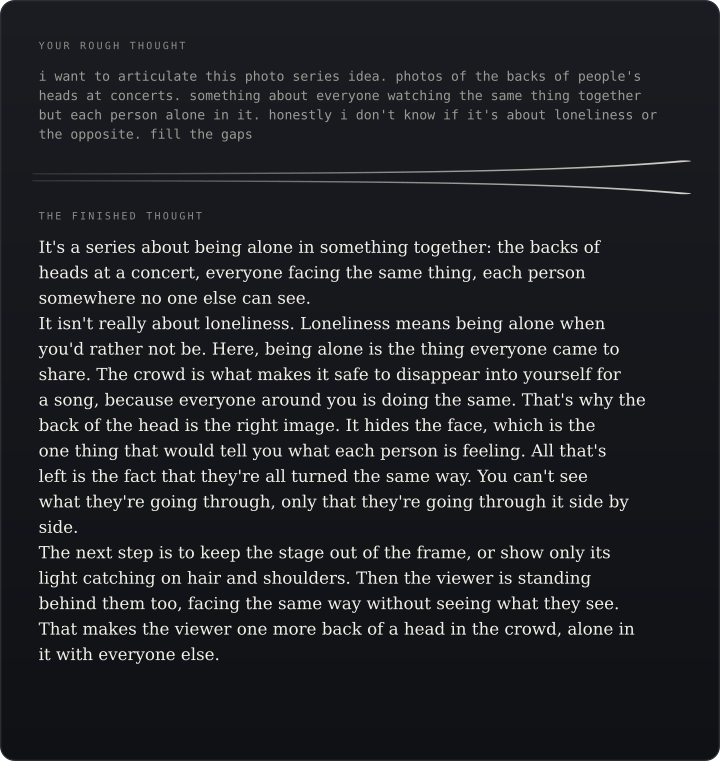

<div align="center">


<h1>fill-gaps-and-restate</h1>

<p>
  <strong>Say it rough. Get back what you meant.</strong><br>
  <sub>An Agent Skill that turns half-formed thoughts into finished ones</sub>
</p>

[](LICENSE)


[](https://buymeacoffee.com/samuelbullard)

<br>



</div>

---

You know what you mean, but it comes out as a ramble, a voice note, or three fragments
and a "you know?". Say **"fill the gaps"** and you get it back the way you would have
said it on a good day: the sentence you were reaching for, the reasoning you skipped
because it felt obvious, and your maybes followed through.

One `SKILL.md`. Works in Claude Code and any agent that reads the
[Agent Skills](https://agentskills.io) format.

## Install

**Claude Code**

```shell
/plugin marketplace add abullard1/fill-gaps-and-restate
/plugin install fill-gaps-and-restate@fill-gaps-and-restate
```

**Any agent that reads `SKILL.md`** (Codex, Cursor, Gemini CLI, and others)

```shell
npx skills add abullard1/fill-gaps-and-restate
```

Or copy [`skills/fill-gaps-and-restate/`](skills/fill-gaps-and-restate/) into your agent's skills folder.

## Use

Paste or dictate the rough thought and say **"fill the gaps"**, **"help me articulate this"**
or **"what am I trying to say?"**. You get the sentence you were reaching for, then where it
goes.

Not for editing, translating or summarising someone else's text, or for factual questions.

## Examples

Real inputs and real Claude Opus answers from the shipped skill, unedited, with nothing else loaded.

<details>
<summary><strong>A creative idea</strong>: a song that isn't quite about a lighthouse</summary>

> help me say what this song is about. it's about a lighthouse keeper but really it's about being the friend everyone calls when something goes wrong, and nobody checks on you. not sad-sad, more warm? maybe from the lighthouse's point of view, not sure

It's a song about the keeper everyone counts on when the storm comes in, sung by the one thing that watches them do it.

The ships only notice the light, never the person keeping it lit. On calm nights nobody thinks about the lighthouse, and that's the proof it worked: the safer everyone is, the less they see you. That's the warm part rather than the sad part. The keeper isn't bitter. This is who they are, and they'd climb the stairs again tonight. It isn't a complaint. It's a quiet look at what it costs to be the one who holds steady.

That's why the lighthouse's point of view is the right call, not just a maybe. It answers your "nobody checks on you." Someone does. The lighthouse sees every night the keeper stays up, every ship they get home that never says thanks, every time they wipe the salt off the glass alone. The song becomes the friend for the friend: a voice saying "I see you, and I've seen all of it." That's what keeps it tender instead of lonely, and it gives you a chorus that's both the lighthouse talking to the keeper and you talking to the people in your life who are always the ones holding the light.

</details>

<details>
<summary><strong>A bold idea</strong>: a company built to finish</summary>

> i can't put this into words yet. a startup that's designed from day one to shut itself down. not fail, finish. like it has a mission and when the mission is done the company dissolves and gives everything away. every company is built to live forever and maybe that's the problem, they outlive their reason and turn into something else. i guess it's like a mortal company? not sure if that's genius or just naive. say what i mean

A company that's built to finish rather than fail: it exists for one mission, and when that mission is done it dissolves and gives everything away, because a company that can't die eventually outlives its reason and turns into something else.

The mortality is the point, not a flaw. When a company is built to live forever, survival quietly becomes the real mission, and the original purpose turns into something it can trade away to keep going. A mortal company can't make that trade, because its ending is written in from day one and every decision is measured against the finish line instead of against staying alive. That answers whether it's genius or naive. It's naive if "mortal" is just a nice feeling. It holds up if the ending is binding: a concrete definition of "done" agreed at the start, written into the charter, with who gets everything already named. Without that, "finish" just becomes another way of saying "live forever."

So the hard question isn't whether a company can choose to end. It's which missions are finite enough to actually be finished. It also changes who would join. People would sign up for a mortal company the way they sign up for an expedition or a film shoot: for something with an ending, where the giveaway at the end is part of the deal from the start.

</details>

<details>
<summary><strong>Mid-conversation</strong>: what an on-call handover needs to do</summary>

> Earlier: *"our on-call handover is chaos."* An assistant suggested a written handover doc with a sign-off; the reply was *"the written part maybe, the sign-off no, that's just bureaucracy."*
>
> right so what i want is that the next person knows what's still burning and what i already tried, so they don't redo it at 2am. doesn't have to be pretty. can you put that into words before we decide the format

A handover should tell the next person what's still burning and what I've already tried, so nobody repeats my work at 2am.

The point isn't to prove a handover happened. It's to pass on what I know, and that's why the sign-off felt like bureaucracy: it serves accountability, not the person coming on shift. The useful part is the dead ends. I'm not just saying "this is broken". I'm saying "I restarted X, it didn't help, and here's what I saw". That's what saves someone an hour in the middle of the night. It also settles the "maybe" about writing it down: it has to be written, because at 2am I'm asleep and they can't ask me.

That gives us the test for any format: could someone tired, who wasn't there, pick it up and know where to start? Rough notes are fine as long as they answer two questions: what's still open, and what have I already ruled out. Anything that doesn't help with those two can go.

</details>

## Author

<table>
  <tr>
    <td>
      
    </td>
    <td>
      <strong>Samuel Ruairí Bullard</strong><br>
      Human-Centred AI @ University of Regensburg · Regensburg, Germany<br>
      <a href="https://github.com/abullard1">GitHub&nbsp;@abullard1</a> ·
      <a href="https://sams3dlibrary.com/">sams3dlibrary.com</a> ·
      <a href="https://x.com/samudschigo">X&nbsp;@samudschigo</a>
    </td>
  </tr>
</table>

Found a real failure? Open an issue with the rough input, what came back, and what you meant.

## License

[MIT](LICENSE) © 2026 [Samuel Ruairí Bullard](https://github.com/abullard1).
